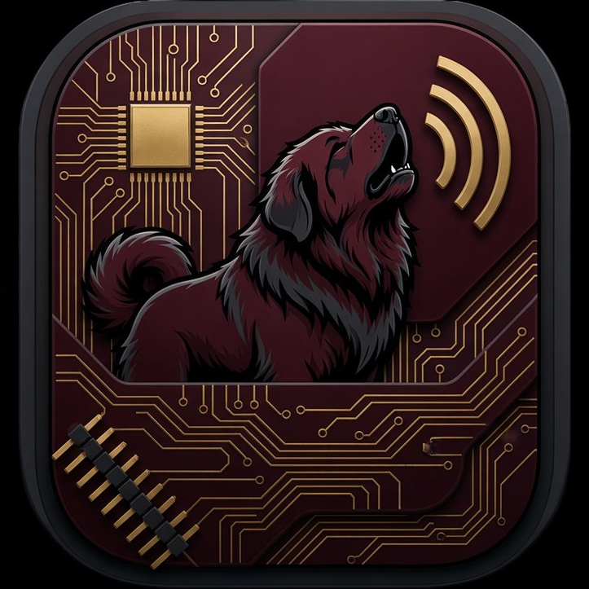

# HowlingDog

A standalone Neo Geo emulator for Android: an original frontend around
the Geolith libretro core — AES, MVS, Neo Geo CD, and Neo Geo CDZ in
one app.

**First release: 0.1.0** — see
[Releases](https://github.com/DocBobert6/HowlingDog/releases) for the
signed APK. The app is free, with no ads.

HowlingDog is not affiliated with or endorsed by SNK Corporation.

## What it is

One system, done properly. Instead of a multi-system frontend where
Neo Geo is one entry in a list, HowlingDog is a dedicated Neo Geo app:
the whole library, the controls, and the display are tuned to the
Neo Geo and to the era it comes from — a fighting-game select grid
for the library (KOF '94/'95, Street Fighter II style), a different
overlay theme per system, and a different CRT shader chain per
system, each matched to the display that system was played on.

## Features

- **Library** — a fighting-game select grid: the picked game big in
  the middle, a grid of portrait tiles, "SELECT YOUR GAME", and a
  decorative countdown. Cover art is fetched automatically from the
  libretro thumbnails collection (Wi-Fi only, one image per game,
  cached on the device); a typographic tile is the fallback when a
  game has no art.
- **All four systems** — AES (Home console), MVS (Arcade), Neo Geo
  CD, and Neo Geo CDZ. Discs default to Neo Geo CD; CDZ is a
  per-game pick. Cartridges are `.NEO` files (TerraOnion format);
  discs are `.bin/.cue` or `.chd`.
- **Per-system overlay themes** — AES gets the arc layout with
  rainbow buttons (A red, B yellow, C green, D blue), MVS gets the
  cabinet layout, CD and CDZ get the diamond layout with grey/silver
  controls. The stick stays a stick in every mode. Buttons are
  movable individually, or together with the Together toggle, and
  resizable from the pause menu. A user-toggleable 8-way D-pad is
  available in Settings — it is never four-way.
- **Per-system CRT shader chains** — AES "Hearth" (1990 home CRT
  TV), MVS "Neon" (arcade CRT monitor), Neo Geo CD "Comet" (1994
  home CRT TV), Neo Geo CDZ "Zenith" (1995 home CRT TV), each with
  its own screen curvature matched to its display. Both can be
  switched off in Settings.
- **Quick save/load** — on-screen SAVE and LOAD buttons beside
  Pause, and L1+R1 together to quick-save / L2+R2 together to
  quick-load on a gamepad. Three save-state slots per game: the
  quick path always uses slot 1, and the pause menu lets you pick
  a slot (a filled dot marks a slot that holds a save) before
  SAVE STATE / LOAD STATE.
- **Gamepad support** — physical-position mapping (bottom face =
  Neo A, right = B, left = C, top = D; Start = Neo Start, Select =
  Neo Coin), D-pad and left stick steer, START+SELECT pauses.
- **Core options** — palette, aspect ratio, sprites per line,
  overclocking, region, overscan, Universe BIOS hardware, memory
  card (on by default), free play, and the CD speed/DMA/loading
  options, in Settings.
- **Per-game settings** — the gear chip on the picked game opens
  that game's own settings: region, palette, aspect ratio, sprites
  per line, overclocking, free play, CRT shader, screen curvature,
  and the left control. Anything left on "Use global" follows
  Settings, and Reset restores the global settings for that game.
  Takes effect the next time the game starts.
- **In-app Licences screen** — Settings → About → Licences shows
  the full licence texts for every library in the app (see
  [NOTICE](NOTICE)).

## Screenshots

Robert's device captures (Pixel 10a).

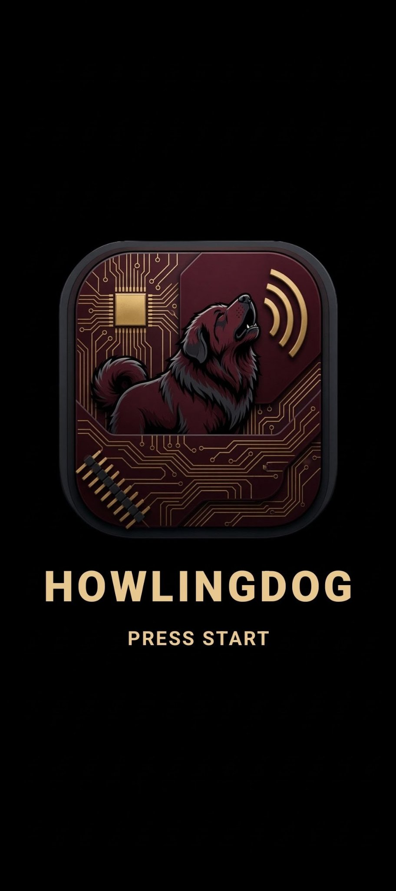

The boot screen — the howling-dog icon, HOWLINGDOG, PRESS START.

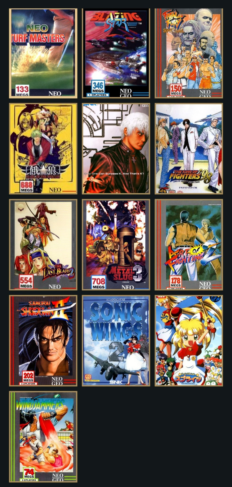

The select grid — all 13 showcase games with their cover art.

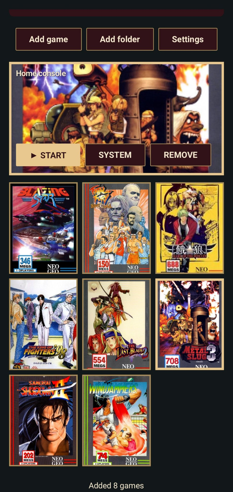

The library with the 8 cartridge games — Metal Slug 3 selected.

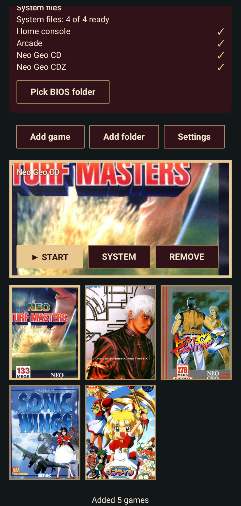

The library with the 5 CD games — Neo Turf Masters selected.

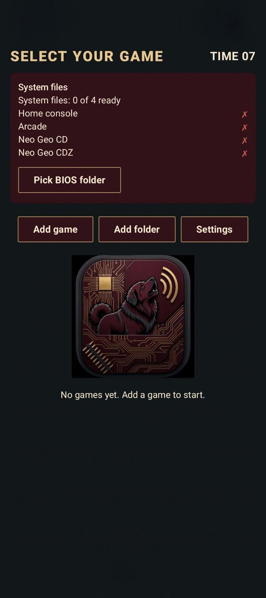

The empty library — "No games yet. Add a game to start." — with
the icon shown in the empty state.

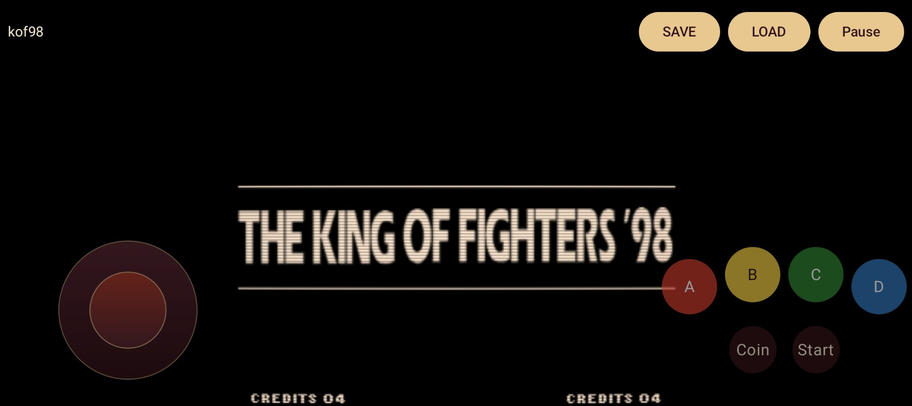

The King of Fighters '98 on AES — the arc buttons (A red, B yellow,
C green, D blue) and the red-tinted stick.

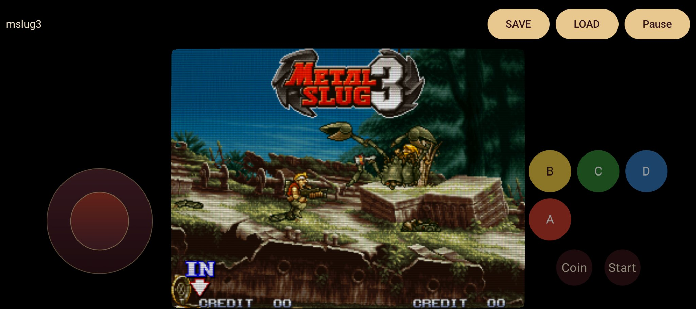

Metal Slug 3 on MVS — the cabinet button layout (B, C, D on the top
row, A below-left).

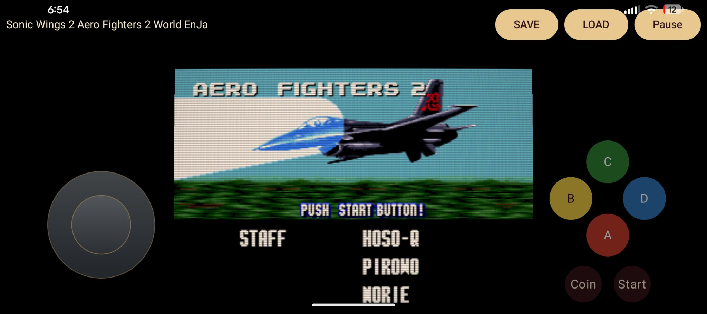

Aero Fighters 2 on Neo Geo CD — the diamond layout (C top, B left,
D right, A bottom) and the grey stick.

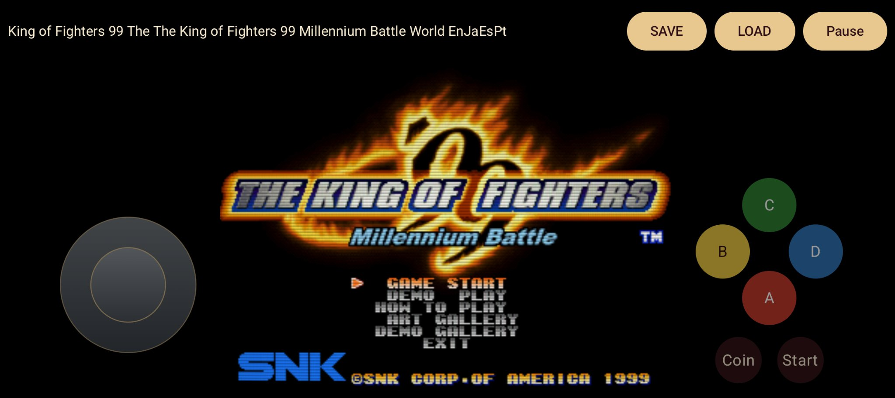

The King of Fighters '99 on Neo Geo CDZ — the diamond layout and
the grey stick.

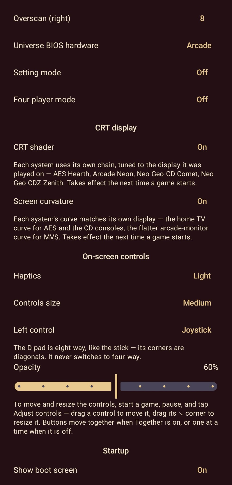

Settings, scrolled to the CRT display section — the per-system chains
(AES Hearth, Arcade Neon, Neo Geo CD Comet, Neo Geo CDZ Zenith) and
screen curvature.

## Games and BIOS — not included

No games, BIOS files, or ROM-download links are in this repo, and
none ever will be. To play, supply your own:

- Cartridges: `.NEO` files (TerraOnion format); convert a MAME set
  with [lithogen](https://github.com/carmiker/lithogen).
- Discs: `.bin/.cue` or `.chd`.
- BIOS zips from a recent MAME set: `aes.zip` (AES), `neogeo.zip`
  (MVS + Universe BIOS), `neocd.zip` + `neocdz.zip` (CD),
  `neocdz.zip` (CDZ), `irrmaze.zip` (Irritating Maze, MVS).

In the app: tap **Pick BIOS folder**, pick the folder holding the
zips; tap **Add game** (or **Add folder**) to import games; tap a
game to start it. The game boots with touch controls (stick or
8-way D-pad, A/B/C/D, Start, Coin) and a pause menu
(CONTINUE?, save/load state, Settings, Adjust controls, Quit to
library).

## Building

CI builds on every push to `main` (see
`.github/workflows/android.yml`): it builds the stock core and the
bridge for arm64-v8a via ndk-build, runs the host core test and the
unit tests (including the Robolectric startup gate and the Licences
gate), then assembles the debug APK (`howlingdog-apk-debug`
artifact). The signed release is built by
`.github/workflows/release.yml`, which runs when a `v*` tag is
pushed and publishes the signed APK to
[Releases](https://github.com/DocBobert6/HowlingDog/releases).

Locally, with the Android SDK + NDK 27 installed:

```sh
# Stock core, arm64 only
cd libretro/jni
$ANDROID_HOME/ndk/27.2.12479018/ndk-build -j"$(nproc)" APP_ABI=arm64-v8a APP_PLATFORM=android-21
# Bridge (after the core — it links the prebuilt libretro.so)
cd ../../bridge/jni
$ANDROID_HOME/ndk/27.2.12479018/ndk-build -j"$(nproc)" APP_ABI=arm64-v8a APP_PLATFORM=android-21
# Stage both .so files for Gradle (build artifacts, never committed)
cd ../..
mkdir -p app/src/main/jniLibs/arm64-v8a
cp bridge/libs/arm64-v8a/*.so app/src/main/jniLibs/arm64-v8a/
# Unit tests (incl. the Robolectric startup gate)
./gradlew :app:testDebugUnitTest
# App (debug, unsigned)
./gradlew :app:assembleDebug
```

A release build (`assembleRelease`) needs the release keystore,
which lives in GitHub Secrets and is only used by the release
workflow — it is never committed to the repo.

## Layout

- `src/`, `libretro/`, `deps/` — Geolith core, BSD-3-Clause (see
  `LICENSE`); the core tree is imported from upstream, pinned at
  commit `2dc88e3fa72ff404213a65d6eb5bb33baa687f73`, with one change:
  the 68k is run in event-batched slices instead of one cycle at a
  time (see `src/geo_slice.h`; the LSPC event points and the
  per-slice bookkeeping are unchanged).
- `app/` — the Android app module (`app.howlingdog`),
  Kotlin/Compose. The frontend is GPL-3.0; its licence text is in
  `frontend/LICENSE`.
- `bridge/` — the JNI bridge (C++), built by ndk-build; it links the
  prebuilt core and is the only native code the frontend owns. It
  exposes the 13 JNI entry points the Kotlin side declares (CI
  verifies all of them).
- `tests/` — the host C test for the core's event-batched slice
  computation.
- `.github/workflows/android.yml` — CI: builds the core and the
  bridge for arm64-v8a, runs the tests, assembles the debug APK.
- `.github/workflows/release.yml` — release: builds the signed APK
  and publishes it to Releases.
- `NOTICE` — full licence texts for every library in the compiled
  core (Geolith, ymfm, Speex, zstd, Musashi, Jolly Good Z80, miniz,
  libretro, LZMA). The in-app Licences screen shows the same texts
  (`app/src/main/res/raw/notice.txt`, kept in sync with `NOTICE`
  by CI).
- `NONBUGS` — quirks confirmed to exist on real hardware, so they
  are not emulation bugs.
- `rename-neo.sh` — upstream helper for the `.NEO` conversion
  (see the core README below).

The core's own README is `README` (upstream Geolith: systems,
formats, BIOS files, compatibility, accuracy notes).

## Licences

- Frontend (`app/`): GNU GPL-3.0 — `frontend/LICENSE`.
- Core (`src/`, `libretro/`, `deps/`): permissive, see `LICENSE`
  and [`NOTICE`](NOTICE) (Geolith BSD-3-Clause; ymfm
  BSD-3-Clause; Speex BSD-3-Clause; zstd BSD; Musashi MIT; Jolly
  Good Z80 MIT; miniz MIT; libretro MIT; LZMA public domain). The
  core is bundled in the APK; the notices in `NOTICE` satisfy the
  binary-redistribution conditions. The in-app Licences screen
  (Settings → About → Licences) shows the same texts.

HowlingDog is not affiliated with or endorsed by SNK Corporation.
No BIOS files, games, or SNK artwork are included.
